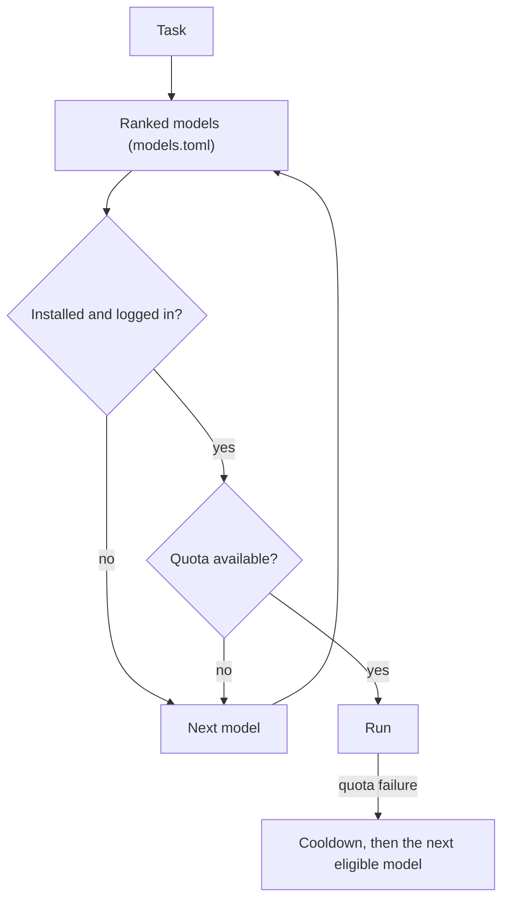

<p align="center">
  
</p>

<p align="center">
  <a href="LICENSE"></a>
  
  
  
</p>

Godfather hands a coding task to one of the AI coding CLIs you already have
installed: Codex, Cursor, Grok, or Antigravity. You rank the models once. Each
task goes to the highest-ranked model that has quota left, and moves to the next
one when quota runs out or a login fails. While the agent works you can check
its status, answer its questions, and send corrections.

It is written in Bash and Python's standard library and needs no Python
packages.

## Quickstart

Install:

```sh
git clone https://github.com/zhast/godfather && cd godfather && ./install.sh
export PATH="$HOME/.local/bin:$PATH"
```

Log in to at least one [supported CLI](#supported-clis), then check what
Godfather can see:

```sh
godfather doctor
```

Run a task:

```sh
CWD=/path/to/project godfather run -p "Fix the parser and run its tests" parser
```

`CWD` is the project directory and `parser` is a name for the run. The brief can
also be a file: `godfather run /tmp/task.md parser`. Each run works in its own
git worktree, or in a scratch copy when the project is outside git, and a
one-shot run never merges.

[Installation](docs/installation.md) covers prerequisites, custom prefixes, and
uninstall.

## How it works



The ranking lives in `${XDG_CONFIG_HOME:-$HOME/.config}/godfather/models.toml`,
created on the first `godfather run` or `godfather quota`. Move a `[[models]]`
block up or down to change the order. When a run falls back to another model,
`godfather status` still shows every segment of it.

## Features

| Feature | What it does |
| --- | --- |
| [Ranked routing](docs/routing-and-quota.md) | Picks the best available model and recovers from quota and login failures. |
| [Plans](docs/plans.md) | Runs a TOML dependency graph of small tasks. Only an integrate task merges, and it does not push. |
| [Policy](docs/policy-and-safety.md) | Timeout, retry, and fallback rules, compiled into each CLI's own allow, deny, and approval settings. An optional container is the hard boundary. |
| [Oversight](docs/policy-and-safety.md#decisions-ask-and-answer) | The agent asks before risky actions and you answer. Policy guards and a private audit log back that up. |
| [Self-healing](docs/supervision.md#self-healing-and-actionable-supervision) | Classifies stalls, crashes, and broken streams, then retries by policy. |
| [Cross-model review](docs/usage.md#cross-model-review) | A second model reviews the finished task and can fix the bugs it finds. |
| [Usage ledger](docs/routing-and-quota.md#cost-and-usage-ledger) | Tokens per segment, optional estimated USD, and quota burn. |
| [Live dashboard](docs/supervision.md#godfather-top) | `godfather top` shows runs, questions, and events, with keyboard controls. |
| [MCP server](docs/mcp-server.md) | Start and supervise runs from Claude Code, Cursor, or Codex. |

## Common commands

```sh
CWD="$PWD" godfather run -p "Fix the parser" parser                      # route a task and wait for it
CWD="$PWD" godfather run -p "Fix the parser" --check "npm test" parser   # run a check after the agent finishes
godfather status                        # active and recent runs
godfather watch --important             # questions, denials, failed checks, completion
godfather nudge parser "message"        # send a correction to a run
godfather answer parser "small"         # answer a question the agent asked
godfather stop parser                   # stop a run and its process tree
godfather quota                         # which models are eligible, and their cooldowns
godfather usage --today --by model      # tokens and optional estimated USD
godfather top                           # live dashboard
godfather plan run examples/plan.toml   # run a dependency graph of tasks
```

## Supported CLIs

Install and log in to the ones you want. Godfather skips the rest.

| CLI | `backend` in `models.toml` | Setup |
| --- | --- | --- |
| [Codex](https://learn.chatgpt.com/docs/codex/cli) | `codex` | Run `codex login`. The binary bundled with ChatGPT.app also works. |
| Cursor | `cursor` | Run `cursor-agent login`, then add an uncommented Cursor block to `models.toml`. See [Cursor CLI backend](docs/cursor.md). |
| [Grok Build](https://github.com/xai-org/grok-build/blob/main/crates/codegen/xai-grok-pager/docs/user-guide/01-getting-started.md) | `grok` | Run `grok login` and finish the browser sign-in. |
| [Antigravity](https://www.antigravity.google/docs/cli/install/) | `agy` | Run `agy` and finish the sign-in. |

Godfather needs macOS or Linux, Python 3.8+, Bash 3.2+, and ordinary Unix
utilities. On Windows, use a Linux environment such as WSL. It never logs you in
and never prints credential values.

## Documentation

- [Installation](docs/installation.md): install, uninstall, prerequisites, login checks.
- [Running tasks](docs/usage.md): `godfather run`, isolation, cleanup, project lessons, checks, dependencies, review.
- [Plans](docs/plans.md): the plan file and the scheduler.
- [Routing and quota](docs/routing-and-quota.md): `models.toml`, multiple accounts, cooldowns, handoffs, the usage ledger.
- [Policy and safety](docs/policy-and-safety.md): permissions, containers, ask and answer, audit logs.
- [Supervision](docs/supervision.md): self-healing, the run store, `doctor`, `top`.
- [MCP server](docs/mcp-server.md): setup and the tool list.
- [Low-level backends](docs/backends.md): `codex-run`, `agy-run`, `grok-run`.
- [Cursor CLI backend](docs/cursor.md): setup, modes, and quota.
- [Configuration](docs/configuration.md): environment variables and the files each run writes.
- [Troubleshooting](docs/troubleshooting.md): common problems and fixes.
- [Architecture](ARCHITECTURE.md): the design behind the code in `bin/`.

## Development

```sh
./tests/smoke.sh
```

The tests use temporary homes and fake binaries, so they never contact a model
service. Bug reports and pull requests are welcome. See
[CONTRIBUTING.md](CONTRIBUTING.md).

## License

MIT. See [LICENSE](LICENSE).
