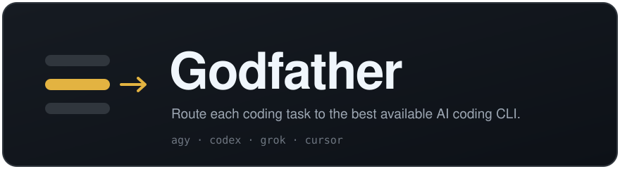
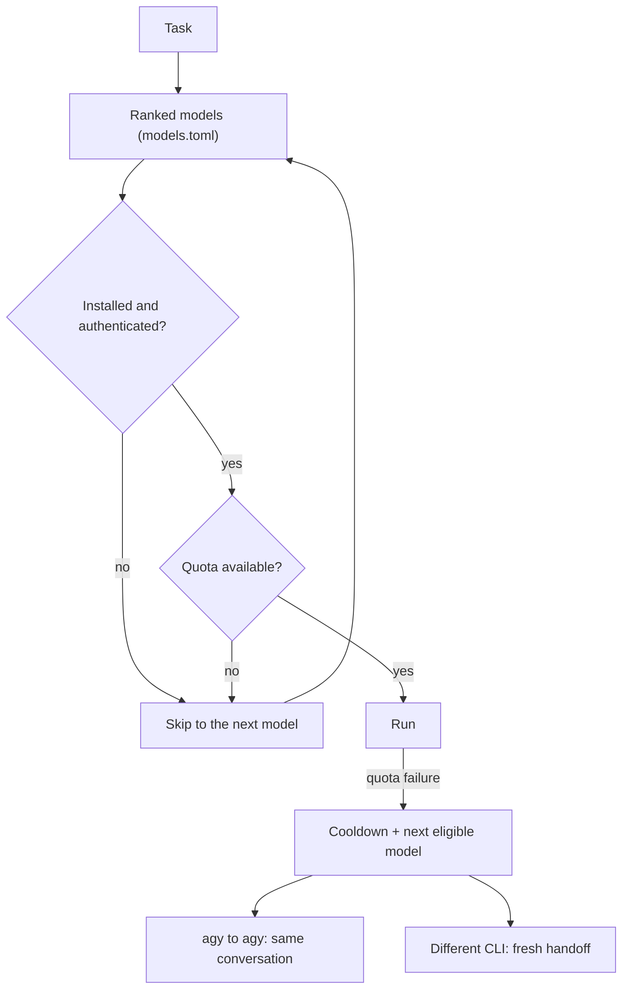

<p align="center">
  
</p>

<p align="center">
  <a href="LICENSE"></a>
  
  
  
</p>

Godfather is a command-line tool that hands a coding task to one of the AI
coding CLIs you already have installed: Antigravity, Codex, Grok, or Cursor.
A single editable ranking uses the best models first and falls back when quota
is exhausted or authentication fails. It also supervises the run, so you can
check status, answer the agent's questions, and send corrections.

Godfather uses Bash and Python's standard library, with no required Python
packages.

## Quickstart

Install:

```sh
git clone https://github.com/zhast/godfather godfather && cd godfather && ./install.sh
export PATH="$HOME/.local/bin:$PATH"
```

Log in to at least one [supported CLI](#supported-clis), then check what
Godfather can see:

```sh
godfather doctor
```

Run a task:

```sh
CWD=/path/to/project godfather run -p "Fix the parser and run its tests" parser
```

`CWD` is the project directory and `parser` is a name for the run. A brief can
also come from a file: `CWD=/path/to/project godfather run /tmp/task.md implement`.
Isolation is the default: each run gets its own git worktree, or a scratch copy
outside git. A one-shot run never merges.

See [Installation](docs/installation.md) for prerequisites, custom prefixes, and
uninstall.

## How it works

Run one command. Godfather chooses the highest-ranked model with available quota
across your installed, authenticated CLIs.



The conductor never picks a CLI. The ranking lives in
`${XDG_CONFIG_HOME:-$HOME/.config}/godfather/models.toml`, created on the first
`godfather run` or `godfather quota`. Move entire `[[models]]` blocks up or down
to reorder it. All segments of a run remain visible through `godfather status`,
`godfather watch`, and `godfather nudge` (aliases for the `agents-*` commands).
Existing `codex-run`, `agy-run`, `grok-run`, and `cursor-run` remain
[low-level backends](docs/backends.md).

## Features

| Feature | What it does |
| --- | --- |
| [Ranked routing](docs/routing-and-quota.md) | Choose available models across Antigravity, Codex, Grok and Cursor; recover from quota and authentication failures. |
| [Plans](docs/plans.md) | A TOML dependency graph of small tasks. Isolation is the default. Only an integrate task merges, and it does not push. |
| [Run store](docs/supervision.md#run-store) | One SQLite database and an explicit status for each run. `status`, `wait`, and `watch` read that status. Progress is a stream heartbeat. |
| [Policy](docs/policy-and-safety.md) | Declarative timeout, retry, and fallback, compiled into each CLI's native allow, deny, and approval settings. An optional container is the hard boundary. |
| [Oversight](docs/policy-and-safety.md#decisions-ask-and-answer) | Ask/answer decisions, policy guards, private audit logs, isolated worktrees and acceptance checks. |
| [Self-healing](docs/supervision.md#self-healing-and-actionable-supervision) | Stalls, crashes, and broken streams are classified and retried by policy. |
| [Usage ledger](docs/routing-and-quota.md#cost-and-usage-ledger) | Segment tokens, optional estimated USD and quota burn. |
| [Cross-model review](docs/usage.md#cross-model-review) | Independent review after a successful task and check, with optional bug fixes. |
| [Live dashboard](docs/supervision.md#godfather-top) | Run status, questions and events with keyboard controls. |
| [MCP server](docs/mcp-server.md) | Background runs and structured supervision from Claude Code, Cursor or Codex. |

## Common commands

```sh
CWD="$PWD" godfather run -p "Fix the parser" parser    # route a task and wait for it
CWD="$PWD" godfather run -p "Fix the parser" --check "npm test" parser   # run an acceptance check after the agent finishes
godfather status                  # active and recent runs
godfather watch --important       # event stream: questions, denials, failed checks, completion
godfather nudge parser "message"  # queue a corrective instruction for a run
godfather answer parser "small"   # answer a question the agent asked
godfather wait parser             # wait for a terminal status
godfather stop parser             # stop a run and its process tree
godfather quota                   # ranked model eligibility, allowance and cooldowns
godfather usage --today --by model   # tokens and optional estimated USD
godfather doctor                  # incidents, suggestions, and CLI login state from files on disk
godfather top                     # live dashboard
godfather plan run examples/plan.toml   # run a dependency graph of tasks
```

## Supported CLIs

Install and authenticate whichever workers you want. The router skips
unavailable workers.

| CLI | `backend` in `models.toml` | What it needs |
| --- | --- | --- |
| [Antigravity](https://www.antigravity.google/docs/cli/install/) | `agy` | Run `agy` and complete the sign-in flow. |
| [Codex](https://learn.chatgpt.com/docs/codex/cli) | `codex` | Run `codex login`; check `codex login status`. The ChatGPT.app bundled binary is also supported. |
| [Grok Build](https://github.com/xai-org/grok-build/blob/main/crates/codegen/xai-grok-pager/docs/user-guide/01-getting-started.md) | `grok` | Run `grok` or `grok login` and complete browser authentication. |
| Cursor | `cursor` | Run `cursor-agent login`, then add an uncommented Cursor block to `models.toml`. See [Cursor CLI backend](docs/cursor.md). |

Godfather needs macOS or Linux, Python 3.8+, Bash 3.2+, and ordinary Unix
utilities. Windows needs a Linux environment such as WSL. Godfather never logs
you in and never prints credential values.

## Documentation

| Page | Contents |
| --- | --- |
| [Installation](docs/installation.md) | Install, uninstall, prerequisites, login checks. |
| [Running tasks](docs/usage.md) | `godfather run`, isolation, cleanup, project lessons, acceptance checks, dependencies, cross-model review. |
| [Plans](docs/plans.md) | The plan file and the scheduler. |
| [Routing and quota](docs/routing-and-quota.md) | `models.toml`, multiple accounts, quota probes, cooldowns, handoffs, the usage ledger. |
| [Policy and safety](docs/policy-and-safety.md) | Native CLI permissions, containers, ask and answer, effect policy, audit logs. |
| [Supervision](docs/supervision.md) | Self-healing, the run store, `doctor`, `top`, `agents-status`, `agents-watch`, `agents-nudge`, Claude Code Monitor integration. |
| [MCP server](docs/mcp-server.md) | Setup for Claude Code, Codex and Cursor, and the tool list. |
| [Low-level backends](docs/backends.md) | `codex-run`, `agy-run`, `grok-run`, and the experimental Codex app-server protocol. |
| [Cursor CLI backend](docs/cursor.md) | Cursor setup, modes, and quota. |
| [Configuration and output files](docs/configuration.md) | Environment variables and the files each run writes. |
| [Troubleshooting](docs/troubleshooting.md) | Common problems and fixes. |
| [Architecture](ARCHITECTURE.md) | The design the `bin/` implementation follows. |

## Development

```sh
./tests/smoke.sh
# Optional, when installed:
shellcheck install.sh bin/codex-run bin/agy-run bin/grok-run bin/cursor-run tests/smoke.sh
```

Tests use temporary homes and fake binaries, exercise all four launchers,
registry/status, global ranking, cooldowns, cross-CLI handoffs, corrective resume,
segment usage/pricing, cross-model review, dashboard snapshots, scripted MCP
initialize/tools/list/status/run/wait sessions, and STALL/SLOW thresholds without
contacting model services. To exercise the official SDK too, set
`TEST_MCP_PYTHON=/path/to/sdk-venv/bin/python` when running `test_features.py`.

## Contributing

Bug reports and pull requests are welcome. See [CONTRIBUTING.md](CONTRIBUTING.md)
for how to run the tests and what to include in a bug report.

## License

MIT licensed; see [LICENSE](LICENSE).
